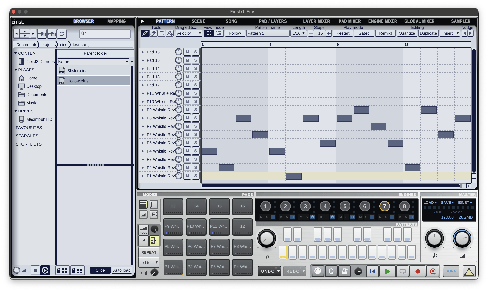
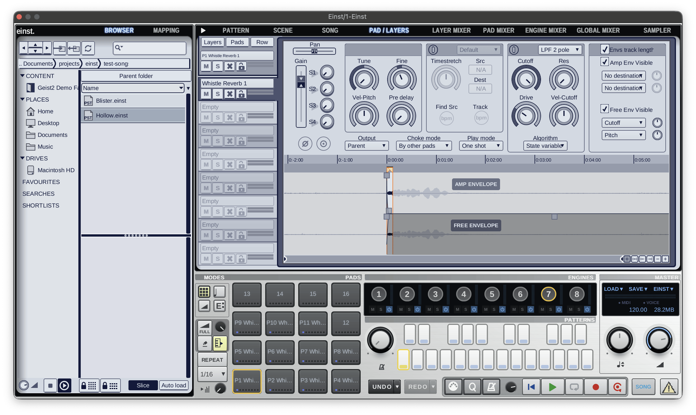
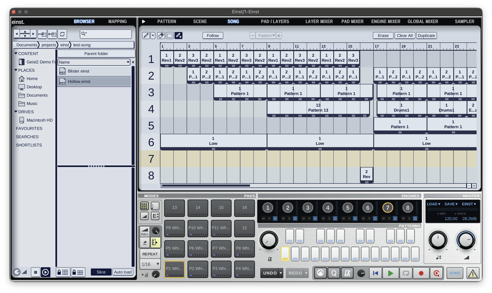
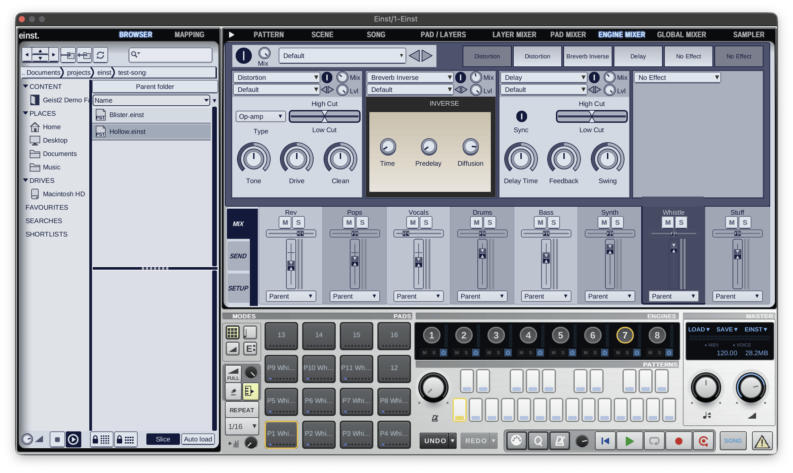
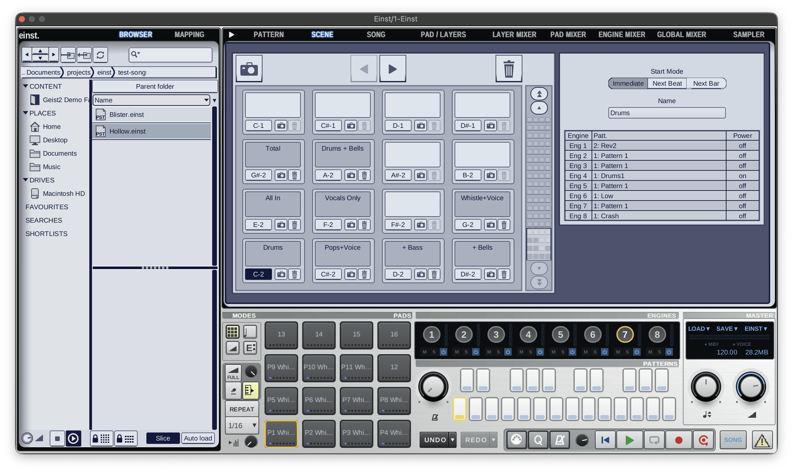
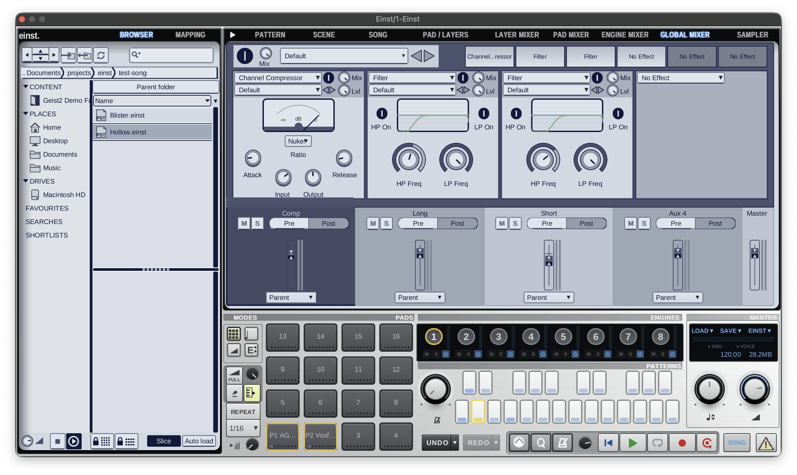

<div align="center">

# Einst

[](https://github.com/koeves/einst/releases/latest)
[](https://github.com/koeves/einst/actions/workflows/release-on-main.yml?query=branch%3Amain)
[](https://github.com/koeves/einst/actions/workflows/ci.yml?query=branch%3Adev)
[](https://github.com/koeves/einst/actions/workflows/codeql.yml?query=branch%3Amain)
[](LICENSE)
[](#install)
[](#install)

</div>

Einst is a drum sampler, step sequencer and performance instrument: a Rust rebuild of FXpansion
**Geist** 1.1.1.2 (2012) with v1's look, effects and sound.

| | |
|---|---|
|  |  |
|  |  |
|  |  |

## Features

- **Instrument**: 8 engines of pads and layers, patterns, scenes, song mode, slicing and effects.
- **Opens**: Geist v1 projects, kits, pads, engines and patterns, plus Geist2 and Dreist files.
- **Saves**: its own `.einst` family (`.einst`, `.einstkit`, ...).
- **Runs as**: VST3, CLAP and a standalone app on macOS, Windows and Linux.
- **Built on**: [dreist-commons](https://github.com/koeves/dreist-commons), shared with [Dreist](https://github.com/koeves/dreist), the Geist2 rebuild.

## Install

Download the archive for your system from the [latest release](https://github.com/koeves/einst/releases/latest), unpack it and run its install script in the unpacked folder.

| System | Requirements | Archive |
|---|---|---|
| macOS | 11+, Apple Silicon | `Einst-<tag>-macOS-AppleSilicon.zip` |
| macOS | 11+, Intel | `Einst-<tag>-macOS-Intel.zip` |
| Windows | 10+, x64 | `Einst-<tag>-Windows.zip` |
| Linux | x86_64, glibc 2.39+, X11 or XWayland | `Einst-<tag>-Linux.tar.gz` |

### macOS

```bash
./install.sh                # this user
sudo ./install.sh --system  # all users
```

- **First launch**: the builds are unsigned, so open the app with right-click › Open › Open.
- **Plugins blocked by a host**: `xattr -dr com.apple.quarantine ~/Library/Audio/Plug-Ins/VST3/Einst.vst3 ~/Library/Audio/Plug-Ins/CLAP/Einst.clap`.
- **REX files**: need the REX Shared Library (Reason Studios), and Rosetta 2 on Apple Silicon.

### Windows

```powershell
.\install.ps1          # all users, in an administrator PowerShell
.\install.ps1 --user   # this user
```

- **Blocked scripts**: `powershell -ExecutionPolicy Bypass -File .\install.ps1`.
- **Runtime**: the [Microsoft Visual C++ Redistributable](https://learn.microsoft.com/cpp/windows/latest-supported-vc-redist) (2015–2022, x64).
- **First launch**: if SmartScreen warns about the unsigned build, choose More info › Run anyway.

### Linux

```bash
./install.sh                # this user
sudo ./install.sh --system  # all users
```

- **Launcher**: the app shows in the desktop's app list, and `einst` starts it.
- **Runtime**: ALSA, OpenGL, X11 and XCB.

## Uninstall

```bash
./install.sh --uninstall           # macOS, Linux (sudo and --system for an all-users install)
.\install.ps1 --uninstall          # Windows (--user for a per-user install)
```

- **Kept**: settings, content and the diagnostics log, unless `--purge` is added.

## Files

| | macOS | Windows | Linux |
|---|---|---|---|
| App | `/Applications/Einst.app` | `%ProgramFiles%\Einst\` | `~/.local/share/Einst/` |
| VST3 | `~/Library/Audio/Plug-Ins/VST3/Einst.vst3` | `%CommonProgramFiles%\VST3\Einst.vst3` | `~/.vst3/Einst.vst3` |
| CLAP | `~/Library/Audio/Plug-Ins/CLAP/Einst.clap` | `%CommonProgramFiles%\CLAP\Einst\` | `~/.clap/Einst/` |
| Settings | `~/Library/Application Support/Einst` | `%APPDATA%\Einst` | `~/.config/Einst` |
| Log | `~/Library/Logs/Einst/einst.log` | `%LOCALAPPDATA%\Einst\Logs\einst.log` | `~/.local/state/Einst/einst.log` |

- **Other installs**: all-users paths on macOS and Linux and per-user paths on Windows are in the [locations table](https://github.com/koeves/dreist-commons/blob/dev/packaging/README.md#locations).
- **Sharing a problem**: main menu › Export diagnostics saves a copy of the log without your user name and private paths.

## Limitations

- **Samples**: none included. Einst plays Geist v1 and Geist2 content (kits, presets, expansions).
- **Drags out of the window**: macOS only.
- **Drops into the window**: macOS and Windows only.
- **REX files**: macOS only.
- **Wayland**: through XWayland.
- **Unsigned builds**: macOS and Windows ask once before the first start.

## Building

```bash
git clone --recursive https://github.com/koeves/einst
scripts/build.sh --install          # macOS
scripts/build-linux.sh --install    # Linux
scripts/build-windows.sh            # Windows, in Git Bash
```

- **Tools**: Rust through [rustup](https://rustup.rs), plus the Xcode Command Line Tools on macOS and Visual Studio Build Tools (C++) with LLVM on Windows.
- **Linux packages** (Debian / Ubuntu): `sudo apt-get install build-essential clang libclang-dev pkg-config libasound2-dev libjack-jackd2-dev libx11-dev libx11-xcb-dev libxcb1-dev libxcb-icccm4-dev libxcb-dri2-0-dev libxcursor-dev libgl1-mesa-dev`.
- **Contributing**: [CONTRIBUTING.md](CONTRIBUTING.md).

## Licence

- **Crates**: MIT OR Apache-2.0.
- **`einst-plugin` and the binaries built from it**: GPL-3.0-or-later.
- **Details**: [LICENSE](LICENSE) and [THIRD_PARTY_NOTICES.md](THIRD_PARTY_NOTICES.md).
- Einst is not affiliated with or endorsed by FXpansion.

## AI usage

Built with assistance of Claude using REA.

Tested by hand and by ear.
