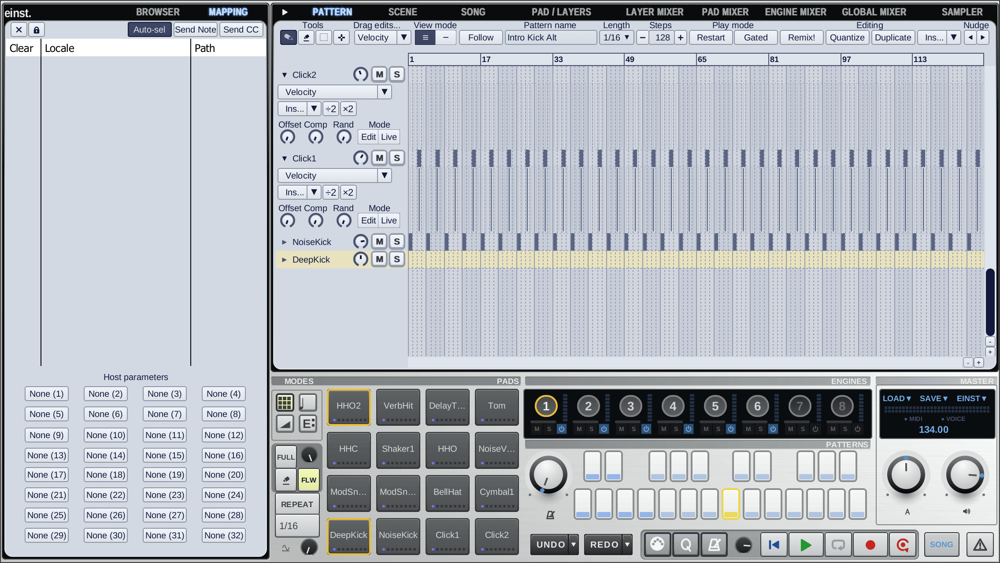
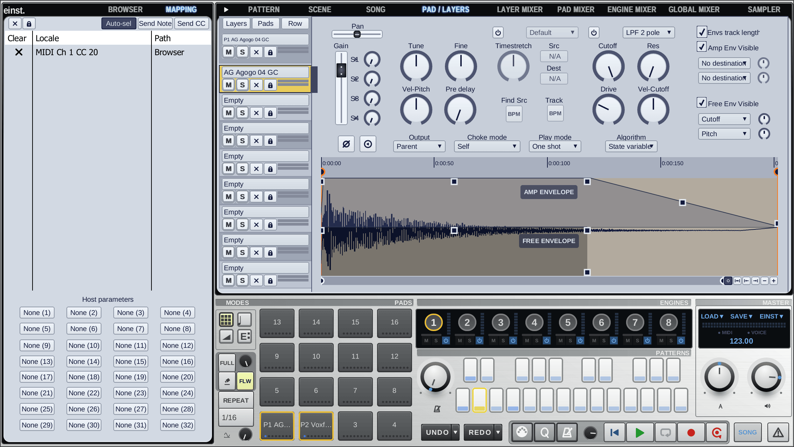
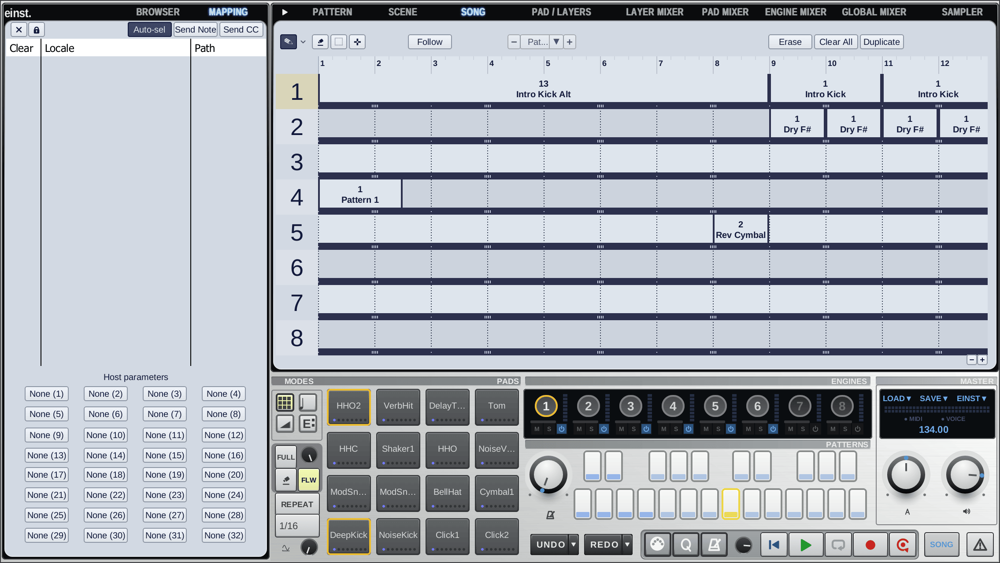
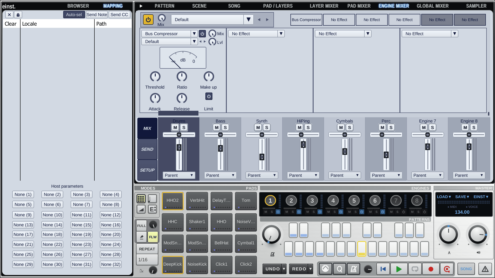

# Einst

- A drum sampler, step sequencer and performance instrument: 8 engines of pads and layers,
  patterns, scenes, song mode, slicing and effects.
- Rebuilt in Rust from the reverse-engineered behaviour of FXpansion **Geist** 1.1.1.2 (2012),
  the predecessor of Geist2, with v1's look, effects and sound.
- Opens Geist v1 projects, kits, pads, engines and patterns (and Geist2 and Dreist files);
  saves its own `.einst` family (`.einst`, `.einstkit`, ...).
- VST3, CLAP and a standalone app for macOS (Apple Silicon).
- Settings: `~/Library/Application Support/Einst`.
- Plugin IDs: CLAP `rs.einst.einst`, VST3 class `EinstRsDrumSmplr`.

| | |
|---|---|
|  |  |
|  |  |

## Installation

Download `Einst-<version>-macOS-VST3.zip`, `-CLAP.zip` and `-App.zip` from the
[releases page](https://github.com/koeves/einst/releases) (latest:
[v0.1.1](https://github.com/koeves/einst/releases/tag/v0.1.1)).

- VST3: unzip and move `Einst.vst3` to `~/Library/Audio/Plug-Ins/VST3/`.
- CLAP: move `Einst.clap` to `~/Library/Audio/Plug-Ins/CLAP/`.
- App: move `Einst.app` to `/Applications` (or `~/Applications`).

The builds are not signed or notarised. Open the app the first time with right-click (or
Control-click) › Open › Open. If a host refuses to load the plugins, clear the quarantine flag:

```bash
xattr -dr com.apple.quarantine ~/Library/Audio/Plug-Ins/VST3/Einst.vst3 ~/Library/Audio/Plug-Ins/CLAP/Einst.clap
```

**Content**

- Einst does not include sample content. Geist v1 and Geist2 kits, presets and expansions load
  as they are.
- v1's factory effect presets, effect chains and pattern and swing templates are bundled.
- A project's samples are found next to it in `<project>.samples/`, as in v1.

## Build

Needs a Rust toolchain.

```bash
scripts/build.sh            # target/bundled/Einst.{app,vst3,clap}
scripts/build.sh --install  # also copies them to ~/Library and ~/Applications
cargo test --workspace
```

Pushing a tag `vX.Y.Z` runs `.github/workflows/release.yml`: it tests and builds on macOS and
publishes the GitHub release with the zips.

## Layout

Einst is an app on [dreist-commons](https://github.com/koeves/dreist-commons), the crates it
shares with Dreist (the Geist2 rebuild). This repository adds what v1 does differently:

| Crate | Role |
|---|---|
| `einst` | App profile: names, theme, resources, file family, v1's effect menu and effect nodes |
| `einst-editor` | Einst's editor: v1's panels, dialogs, menus and settings |
| `einst-formats` | Geist v1 file reader, converted onto the shared document |
| `einst-dsp` | v1's own effects (Gain, Vari-EQ, Envelope Shaper) and v1's versions of the shared ones |
| `einst-plugin` | nih-plug VST3 / CLAP / standalone |
| `xtask` | nih-plug bundler |

## Contributing

- Commits follow Conventional Commits (`feat(scope): ...`); the changelog and release notes
  are generated from them ([CONTRIBUTING.md](CONTRIBUTING.md)).
- Checks: `cargo fmt --all --check`,
  `cargo clippy --workspace --all-targets --features einst-plugin/standalone -- -D warnings`,
  `cargo test --workspace`.
- dreist-commons is a submodule at `commons`: clone with `--recursive`.
- Git conventions for contributors and agents: [`.agents/git.md`](.agents/git.md).

## Related projects

- [dreist-commons](https://github.com/koeves/dreist-commons): the shared library (formats, DSP,
  engine, GUI toolkit) that both apps are built on.
- [Dreist](https://github.com/koeves/dreist): the Geist2 rebuild, an app on dreist-commons.
- [Einst](https://github.com/koeves/einst): the Geist v1 rebuild, an app on dreist-commons.

## Licence

The crates are MIT OR Apache-2.0. `einst-plugin` and the binaries built from it are
GPL-3.0-or-later. See [`LICENSE`](LICENSE) and [`THIRD_PARTY_NOTICES.md`](THIRD_PARTY_NOTICES.md).
Einst is not affiliated with or endorsed by FXpansion.
