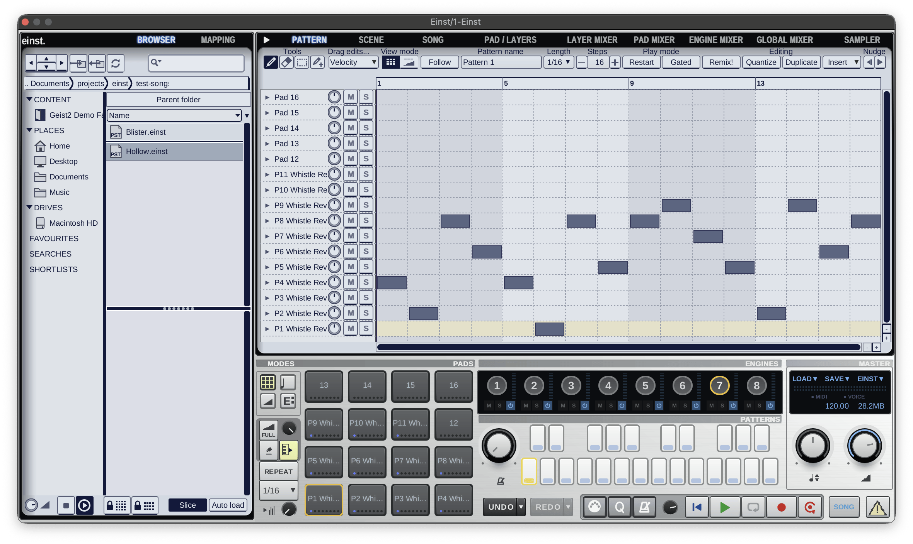
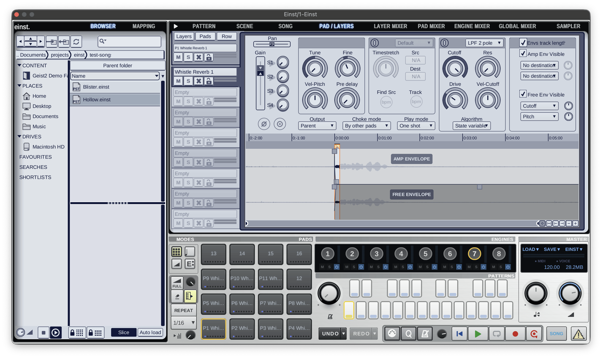
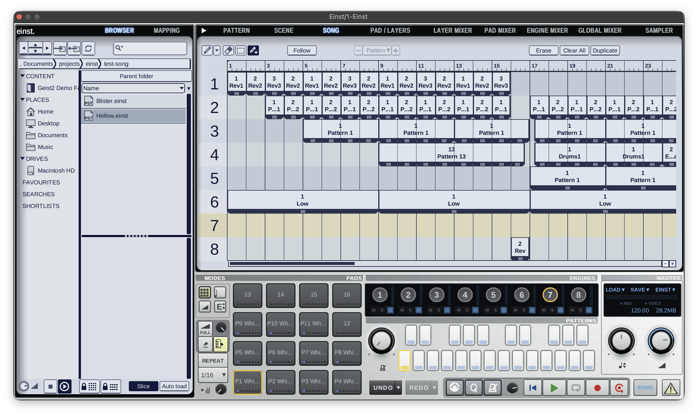
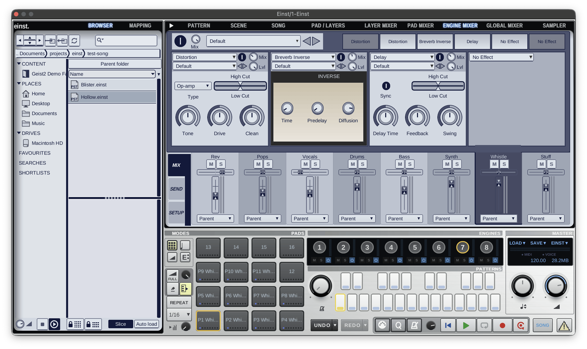
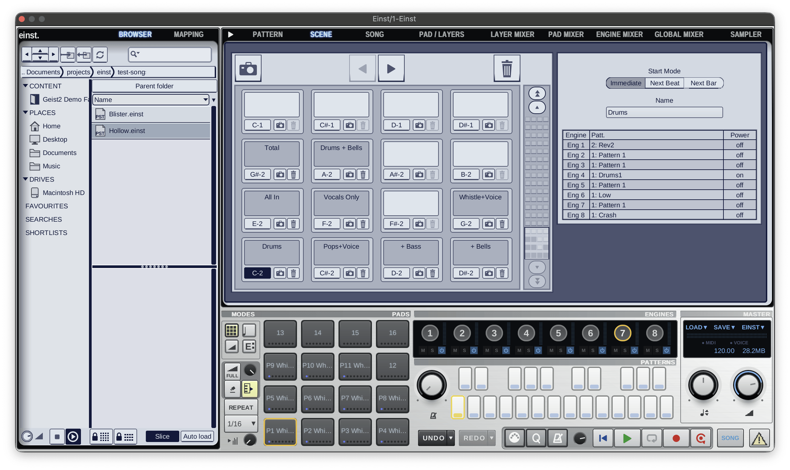
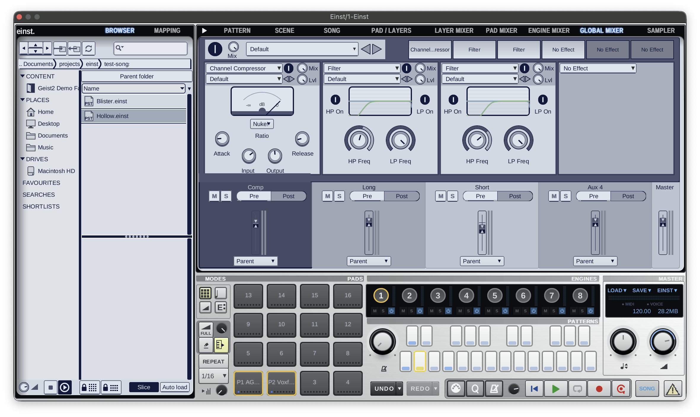

<div align="center">

# Einst

[](https://github.com/koeves/einst/releases/latest)
[](https://github.com/koeves/einst/actions/workflows/release.yml)
[](https://github.com/koeves/einst/actions/workflows/ci.yml)
[](https://github.com/koeves/einst/actions/workflows/codeql.yml)
[](LICENSE)
[](#installation)
[](#installation)

</div>

Einst is a drum sampler, step sequencer and performance instrument: a Rust rebuild of FXpansion
**Geist** 1.1.1.2 (2012) with v1's look, effects and sound.

| | |
|---|---|
|  |  |
|  |  |
|  |  |

## Highlights

- **Instrument**: 8 engines of pads and layers, patterns, scenes, song mode, slicing and effects.
- **Opens**: Geist v1 projects, kits, pads, engines and patterns, plus Geist2 and Dreist files.
- **Saves**: its own `.einst` family (`.einst`, `.einstkit`, ...).
- **Runs as**: VST3, CLAP and a standalone app on macOS, Windows and Linux.

## Contents

- [Installation](#installation)
- [Content](#content)
- [Building](#building)
- [Layout](#layout)
- [Contributing](#contributing)
- [Related projects](#related-projects)
- [Licence](#licence)

## Installation

Download the archives for your system from the [latest release](https://github.com/koeves/einst/releases/latest).

| System | Requirements | VST3 | CLAP | App |
|---|---|---|---|---|
| macOS | 11+, Apple Silicon | `Einst-<tag>-macOS-VST3.zip` | `Einst-<tag>-macOS-CLAP.zip` | `Einst-<tag>-macOS-App.zip` |
| Windows | 10+, x64 | `Einst-<tag>-Windows-VST3.zip` | `Einst-<tag>-Windows-CLAP.zip` | `Einst-<tag>-Windows-App.zip` |
| Linux | x86_64, glibc 2.39+, X11 or XWayland | `Einst-<tag>-Linux-VST3.tar.gz` | `Einst-<tag>-Linux-CLAP.tar.gz` | `Einst-<tag>-Linux-App.tar.gz` |

### macOS

- **VST3**: move `Einst.vst3` to `~/Library/Audio/Plug-Ins/VST3/`.
- **CLAP**: move `Einst.clap` to `~/Library/Audio/Plug-Ins/CLAP/`.
- **App**: move `Einst.app` to `/Applications`.
- **First launch**: the builds are unsigned, so open the app with right-click › Open › Open.
- **Plugins blocked by a host**: clear the quarantine flag.
- **Uninstall**: delete `Einst.vst3`, `Einst.clap` and `Einst.app` from those folders.

```bash
xattr -dr com.apple.quarantine ~/Library/Audio/Plug-Ins/VST3/Einst.vst3 ~/Library/Audio/Plug-Ins/CLAP/Einst.clap
```

### Windows

- **VST3**: move the `Einst.vst3` folder to `C:\Program Files\Common Files\VST3\`.
- **CLAP**: move the `Einst` folder (`Einst.clap` and `Resources`) to `C:\Program Files\Common Files\CLAP\`.
- **App**: unzip the `Einst` folder anywhere and run `Einst.exe`; keep `Resources` next to it.
- **First launch**: the builds are unsigned; if SmartScreen warns, choose More info › Run anyway.
- **Uninstall**: delete the `Einst.vst3` and `Einst` folders from those places, and the app folder.

### Linux

- **Install**: unpack `Einst-<tag>-Linux.tar.gz` and run `./install.sh` in its folder; it sets up the VST3, CLAP, app, launcher and icon for your user.
- **Uninstall**: run `./install.sh --uninstall`; settings and content stay.
- **By hand**: `Einst.vst3` goes in `~/.vst3/`, the `Einst` CLAP folder in `~/.clap/`, and the `Einst` app folder anywhere (run `Einst`, keep `Resources` next to it).
- **Runtime**: ALSA, X11 / XCB and OpenGL, present on desktop systems.
- **File dialogs**: through the XDG desktop portal, or `zenity` without one.
- **Standalone audio**: smoothest on PipeWire (Ubuntu 24.04+); on PulseAudio, raise the buffer in the audio settings or run `Einst --backend jack` with JACK.

### Settings

- **macOS**: `~/Library/Application Support/Einst`.
- **Windows**: `%APPDATA%\Einst`.
- **Linux**: `~/.config/Einst` (or `$XDG_CONFIG_HOME/Einst`).
- **Uninstalling** leaves this folder and your content in place; delete them by hand to remove everything.

### Limitations

- **REX files** (`.rx2`, `.rex`) load on macOS only.
- **Dragging samples** out of Einst into a host or file manager works on macOS only.
- **Wayland** desktops run Einst through XWayland.

## Content

- **Samples**: none included; Geist v1 and Geist2 kits, presets and expansions load as they are.
- **Bundled**: v1's factory effect presets, effect chains, and pattern and swing templates.
- **Project samples**: found next to the project in `<project>.samples/`, as in v1.

## Building

Needs a Rust toolchain.

```bash
git clone --recursive https://github.com/koeves/einst
scripts/build.sh                  # macOS: target/bundled/Einst.{app,vst3,clap}
scripts/build.sh --install        # macOS: also into ~/Library/Audio/Plug-Ins and /Applications
scripts/build-windows.sh          # Windows, in Git Bash
scripts/build-linux.sh            # Linux
scripts/build-linux.sh --install  # Linux: also install for this user (target/bundled/install.sh)
scripts/build-linux.sh --uninstall  # Linux: remove that install
cargo test --workspace
```

Linux build packages (Debian / Ubuntu names):

```bash
sudo apt-get install build-essential clang libclang-dev pkg-config libasound2-dev libjack-jackd2-dev libx11-dev libx11-xcb-dev libxcb1-dev libxcursor-dev libgl1-mesa-dev
```

## Layout

Einst is an app on [dreist-commons](https://github.com/koeves/dreist-commons); this repository holds what v1 does differently.

| Crate | Role |
|---|---|
| `einst` | App profile: names, theme, resources, file family, v1's effect menu and nodes |
| `einst-editor` | v1's panels, dialogs, menus and settings |
| `einst-formats` | Geist v1 file reader |
| `einst-dsp` | v1's own effects and v1's versions of the shared ones |
| `einst-plugin` | VST3, CLAP and standalone (nih-plug) |
| `xtask` | Bundler |

- `assets/ui-v1`: the UI, generated by `scripts/uigen/uigen.py`.
- `assets/factory`: v1's factory presets and templates.

## Contributing

- Commits, checks, branches and releases: [CONTRIBUTING.md](CONTRIBUTING.md).

## Related projects

- [dreist-commons](https://github.com/koeves/dreist-commons): the shared formats, DSP, engine and GUI crates.
- [Dreist](https://github.com/koeves/dreist): the Geist2 rebuild on the same crates.

## Licence

- **Crates**: MIT OR Apache-2.0.
- **`einst-plugin` and the binaries built from it**: GPL-3.0-or-later.
- **Details**: [LICENSE](LICENSE) and [THIRD_PARTY_NOTICES.md](THIRD_PARTY_NOTICES.md).
- Einst is not affiliated with or endorsed by FXpansion.

## AI usage

Built with assistance of Claude using REA.

Tested by hand and by ear.
